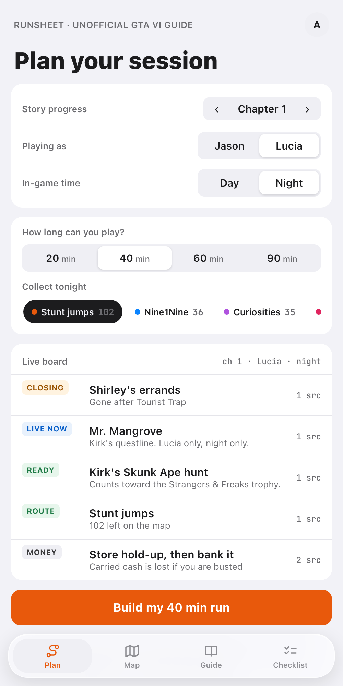
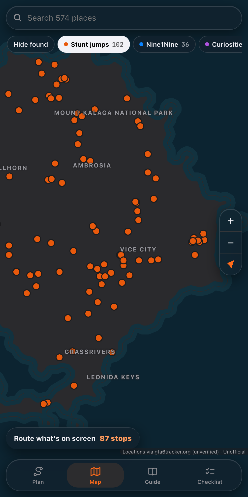
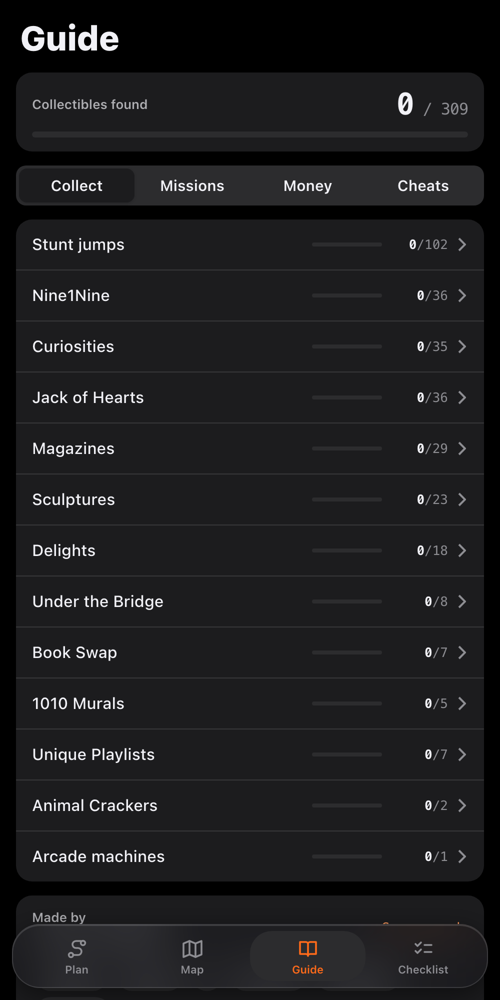
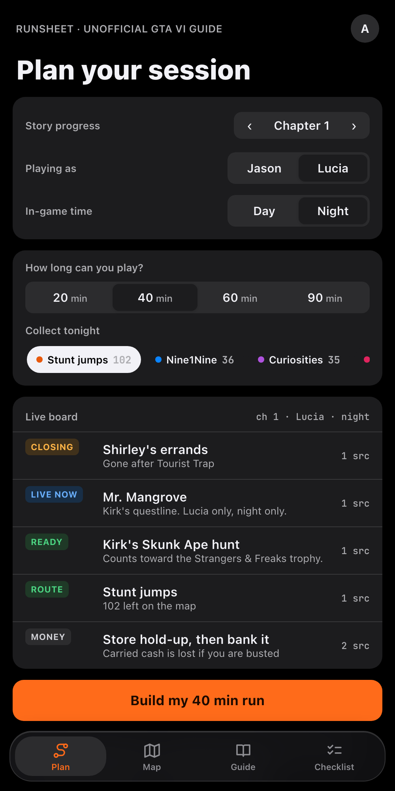
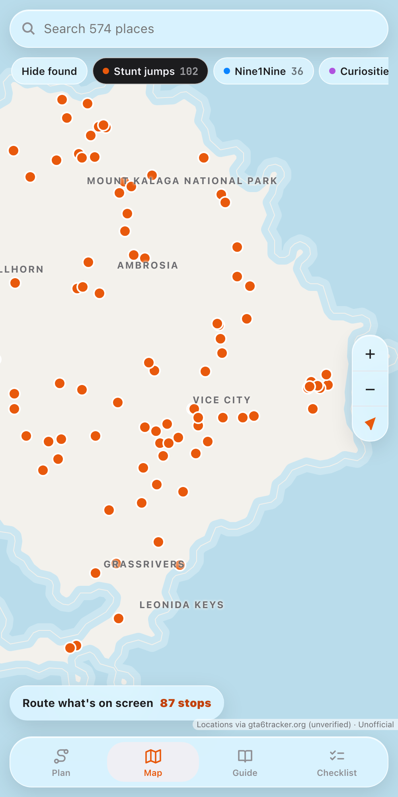
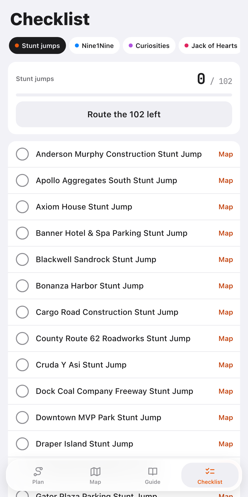

<div align="center">


# Runsheet

**An unofficial GTA VI companion that plans your session.**

Tell it your chapter, who you're playing and how long you've got. It builds a run: what's about to close, what's live right now, a route through the collectibles you still need, and a money stop to finish.

[**Open the app**](https://alireza12t.github.io/gta6-runsheet/) · [Report a wrong spot](https://github.com/alireza12t/gta6-runsheet/issues) · Free, no account, works offline

</div>

<p align="center">
  
  
  
</p>

## Why another GTA VI guide?

Every other guide is a list or a pin map. Runsheet tells you **what to do tonight**.

- **Plan:** set your chapter, Jason or Lucia, day or night, and 20 to 90 minutes. The live board puts missables first, then what's only open right now, then a route and a money stop.
- **Runs:** one tap builds the session. A progress line, the next stop in big type, Done or Skip, and what's coming up. Each finished stop is ticked off your checklist.
- **Routes:** a suggested order through what you haven't found, nearest first, with crossings removed. You can route a whole category, or just what's on your screen.
- **Map:** pinch zoom, 26 filters, search across 574 places, waypoint, mark found, hide found.
- **Guide:** collectible progress, story missions by chapter, Strangers & Freaks, money tips, 18 cheats and 55 trophies.
- **Honest data:** every tip shows how many sources agree. We don't make up payout numbers.
- **Feels native:** light and dark mode, liquid glass touches, installs to your home screen and works offline.

<p align="center">
  
  
  
</p>

## Install it on your phone

- **iPhone:** open the link in Safari, tap Share, then **Add to Home Screen**.
- **Android or desktop Chrome:** tap **Install** on the Plan screen, or use the install icon in the address bar.

Your progress stays on your device. Nothing is sent anywhere.

## Run it locally

No build step. It's plain HTML, CSS and JavaScript.

```bash
git clone https://github.com/alireza12t/gta6-runsheet.git
cd gta6-runsheet
python3 -m http.server 5173
```

Then open http://localhost:5173.

| File | What it does |
|---|---|
| `app.js` | Screens: Plan, Map, Guide, Checklist, Run |
| `route.js` | Route solver (nearest neighbour, then 2-opt) |
| `styles.css` | Light and dark themes, liquid glass |
| `sw.js` | Offline cache |
| `data/` | Places, guide, plan items, money tips, map outline |

## Status

Built three days after launch, so the data is still filling in.

- 43 of 91 story missions are listed so far, and 23 of them have a chapter.
- Route lengths are shown as stops, not minutes, until real drive times are measured.

Found a wrong spot or a missing collectible? [Open an issue](https://github.com/alireza12t/gta6-runsheet/issues).

## Credits

- **Made by [Alireza Toghiani](https://alireza12t.github.io/)**: [GitHub](https://github.com/alireza12t) · [X](https://x.com/DevMvRick) · [YouTube](https://www.youtube.com/@DevMvRick) · [Instagram](https://www.instagram.com/devmvrick) · [LinkedIn](https://www.linkedin.com/in/alireza12t)
- **Map art:** © Rockstar Games, via the [GTA Wiki](https://gta.fandom.com/). Borders and labels are drawn by us.
- **Location data:** via [gta6tracker.org](https://gta6tracker.org/), which builds on the [GTA Wiki](https://gta.fandom.com/) (CC BY-SA). Unverified.
- **Guide tips:** summarised from public guides, with a source count on each.
- **Design:** inspired by the calm, departure-board approach of [Flighty](https://flighty.com/).
- **Map library:** [Leaflet](https://leafletjs.com/).

## Disclaimer

Unofficial fan project. Not affiliated with, endorsed by or connected to Rockstar Games or Take-Two Interactive. Grand Theft Auto, GTA, the map art and related marks belong to their owners. If you're a rights holder and want something removed, open an issue.
